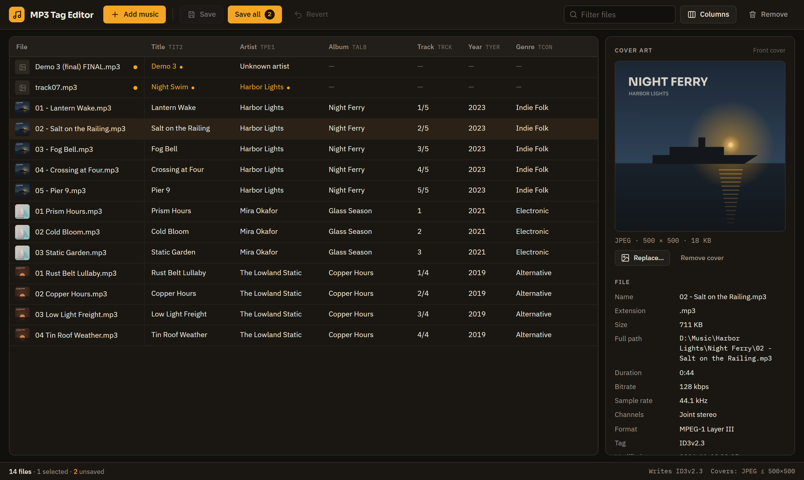
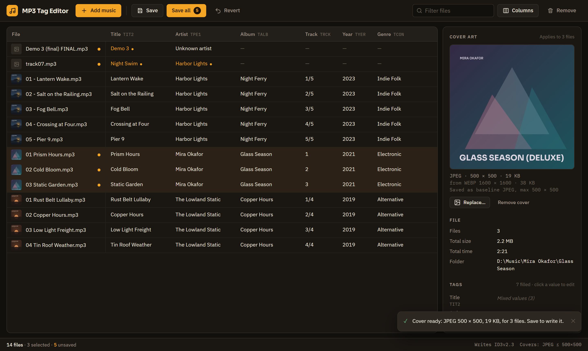
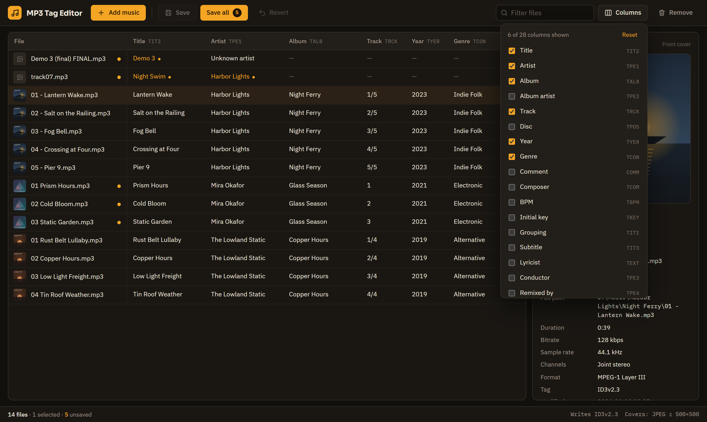
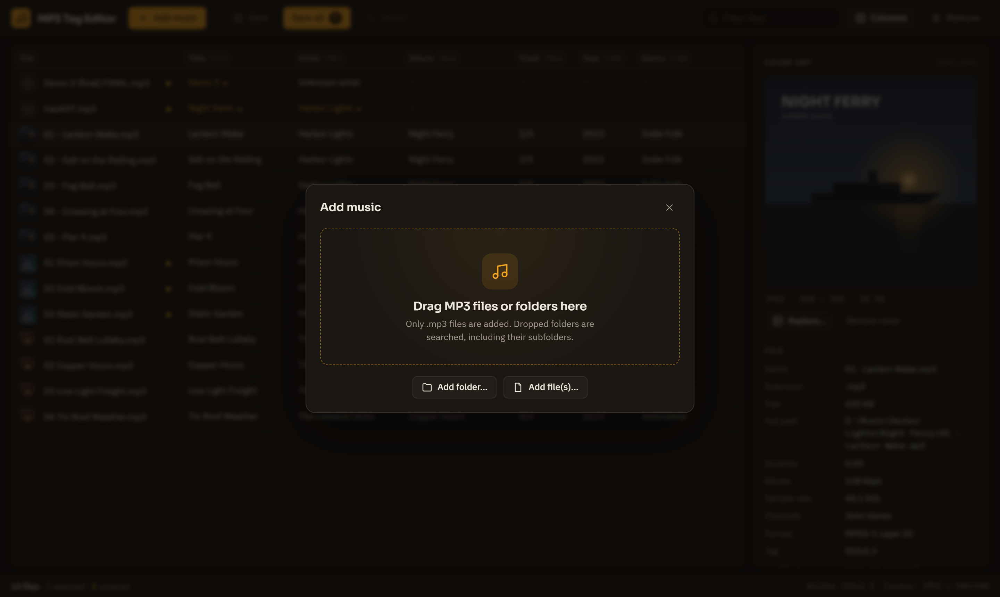

<div align="center">


# MP3 Tag Editor

**A fast, good-looking tag editor for your MP3 collection.**
Edit ID3 tags in a spreadsheet-style table, drop in cover art from any image format, and save clean ID3v2.3 tags that every player understands.




</div>

## Features

- **Spreadsheet-style editing.** Click any cell to edit it. <kbd>Enter</kbd> moves down, <kbd>Tab</kbd> moves right, <kbd>Esc</kbd> cancels.
- **All the fields.** Title, Artist and Album are shown by default. Turn on any of the 28 ID3 fields as a column: track, disc, year, genre, composer, BPM, key, lyrics and more.
- **Edit many files at once.** Ctrl+click or Shift+click a whole album, then change a field or the cover for all of it. Fields that differ show as *Mixed values*.
- **Cover art from any image.** Drop or pick AVIF, WebP, PNG, JPG, GIF, BMP or TIFF. It's converted to a **baseline JPEG of at most 500×500**, the format car stereos, phones and Windows all show.
- **Everything about the file.** The side pane shows the cover, size, full path, duration, bitrate, sample rate, channels and every filled-in tag.
- **Nothing changes until you save.** Edited values turn amber. Use **Save**, **Save all** (<kbd>Ctrl</kbd>+<kbd>S</kbd>) or **Revert**. Closing with unsaved changes asks first.
- **Safe saving.** Each file is written to a temporary copy first and then swapped in, so a crash or a file open in another program never leaves a broken MP3.
- **Add music your way.** Drag files or whole folders (subfolders included) onto the window, or use **Add folder…** / **Add file(s)…**.

## Screenshots

<table>
  <tr>
    <td width="50%"></td>
    <td width="50%"></td>
  </tr>
  <tr>
    <td align="center"><b>Edit a whole album</b><br><sub>One cover for three files, converted from WebP</sub></td>
    <td align="center"><b>Pick your columns</b><br><sub>Every ID3v2.3 field, with its frame ID</sub></td>
  </tr>
  <tr>
    <td colspan="2"></td>
  </tr>
  <tr>
    <td colspan="2" align="center"><b>Add music</b><br><sub>Drag and drop, or choose a folder or files</sub></td>
  </tr>
</table>

## How tags are saved

| | |
| --- | --- |
| **Tag version** | Always written as **ID3v2.3**, the most widely supported version (Windows Explorer, older players, car stereos). |
| **Reading** | ID3v1, ID3v2.2, ID3v2.3 and ID3v2.4 tags are all read. v2.4 dates and multi-value fields are carried over. |
| **Text** | ISO-8859-1 when possible, otherwise UTF-16, so accents and non-Latin scripts are kept. |
| **Cover art** | Saved as the *front cover* picture, baseline JPEG, max 500×500. A small baseline JPEG is kept exactly as it is. |
| **Other data** | Frames the editor doesn't show (ReplayGain, iTunes data, other pictures…) are kept. An existing ID3v1 tag is updated to match. |

## Getting started

### Requirements

- Windows 10 or 11 (WebView2 is built in)
- [Go](https://go.dev/dl/) 1.26 or newer
- [Node.js](https://nodejs.org/) 20 or newer
- The Wails CLI:

```bash
go install github.com/wailsapp/wails/v2/cmd/wails@latest
```

### Build the app

```bash
git clone https://github.com/vincentrathbone-web/mp3-tag-editor.git
cd mp3-tag-editor
wails build -trimpath -ldflags "-s -w"
```

The app is written to `build\bin\MP3 Tag Editor.exe`. It's a single file of about 17 MB, with no installer needed.

### Develop

```bash
wails dev
```

This opens the app with live reload. It also serves the app at <http://localhost:34115>, so you can work on it in a browser while the buttons still call the real Go code. Dropping music only works in the app window, because a browser can't see where dropped files are stored.

### Tests

```bash
go test .
```

Need some music to try it with? This creates a small library of silent sample MP3s:

```powershell
$env:MP3TE_SAMPLES_DIR = "D:\temp\mp3-samples"; go test -run TestMakeSamples .
```

## Keyboard shortcuts

| Keys | Action |
| --- | --- |
| <kbd>Enter</kbd> | Save the cell and edit the one below |
| <kbd>Tab</kbd> / <kbd>Shift</kbd>+<kbd>Tab</kbd> | Save the cell and move right / left |
| <kbd>Esc</kbd> | Cancel the edit, or close a dialog |
| <kbd>Ctrl</kbd>+<kbd>S</kbd> | Save all changed files |
| <kbd>Ctrl</kbd>+<kbd>A</kbd> | Select all files in the list |
| <kbd>Ctrl</kbd>+click / <kbd>Shift</kbd>+click | Add to the selection / select a range |

## Project layout

| Path | What it does |
| --- | --- |
| `app.go` | Functions the window calls: pick files, load, convert covers, save |
| `id3.go` | Reads ID3v1 / v2.2 / v2.3 / v2.4 and writes clean ID3v2.3 |
| `mpeg.go` | Duration, bitrate and sample rate from the audio (Xing, Info and VBRI aware) |
| `cover.go` | Turns any supported image into the 500×500 JPEG cover |
| `track.go` | Loads files and folders in parallel |
| `fields.go` | The list of tag fields (keep it in step with `frontend/src/fields.ts`) |
| `frontend/src` | The React + TypeScript screen |

## Built with

[Wails](https://wails.io) · [Go](https://go.dev) · [React](https://react.dev) · [Vite](https://vite.dev) · [gen2brain/avif](https://github.com/gen2brain/avif) · [golang.org/x/image](https://pkg.go.dev/golang.org/x/image) · [IBM Plex](https://www.ibm.com/plex/) and [Sora](https://fonts.google.com/specimen/Sora) fonts

<sub>The music in the screenshots is made up. The sample files are silent and generated by the test suite.</sub>
